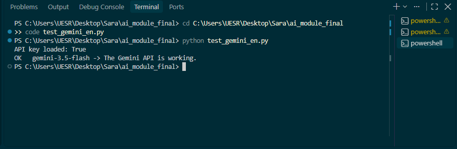
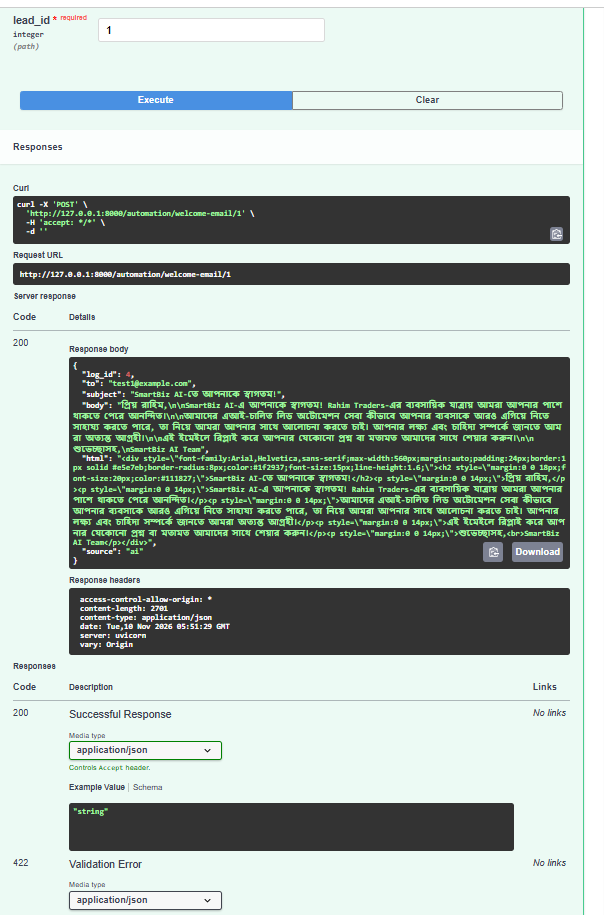
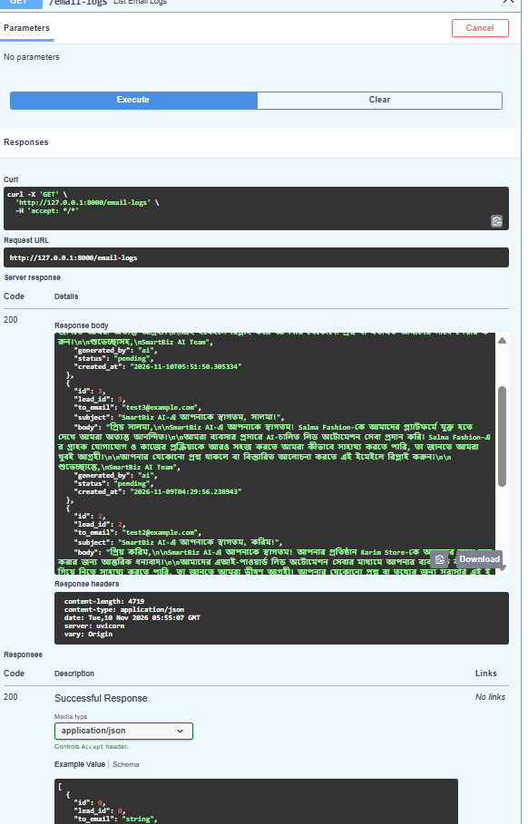
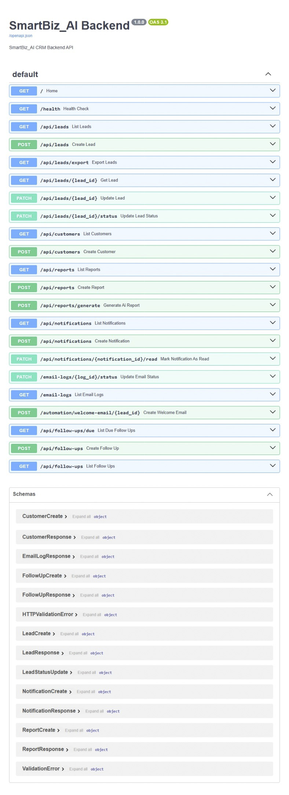
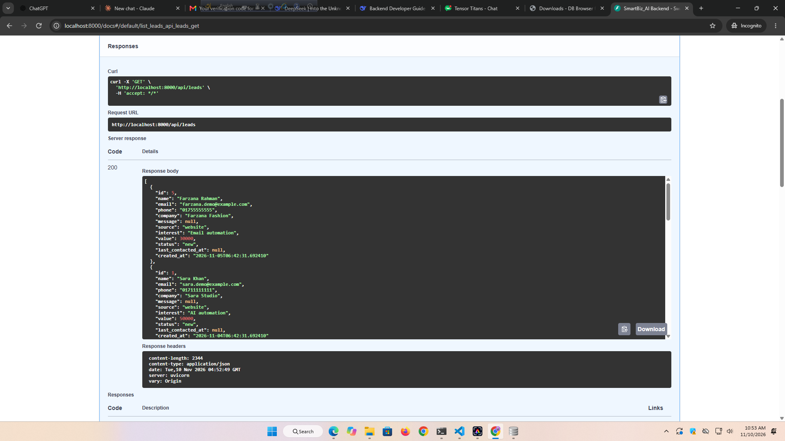
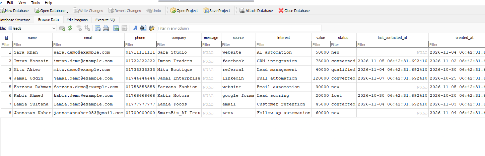
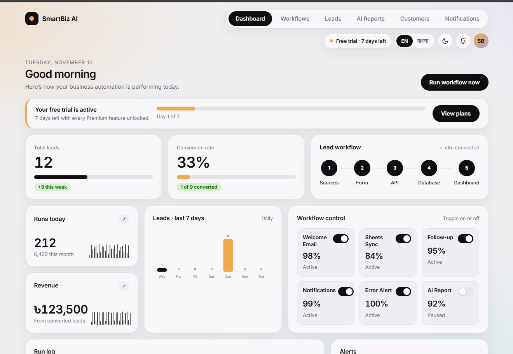

# SmartBiz AI — Final Project Report

## 1. Cover Page
- **Project Name:** SmartBiz AI — Business Automation System
- **Course:** Week 3 — Business Automation (n8n + AI Agent)
- **Submitted by:** Team SmartBiz AI
- **Team Members:**
  1. Tahsin Arshad — Team Leader & System Architect (Member 1)
  2. Jannatun Naher — Automation Engineer (n8n) (Member 2)
  3. Anika Fareen Sara — AI & Python Developer (Gemini) (Member 3)
  4. Marzia Joli — Backend Developer (FastAPI, SQLite) (Member 4)
  5. Hb On — Frontend Developer (Dashboard) (Member 5)
  6. Tasfia Rifa — Testing & Documentation (Member 6)
- **Submission Date:** 10 November 2026
- **GitHub Repository:** https://github.com/tanvee-designs/SmartBiz_AI

---

## 2. Project Overview
SmartBiz AI হলো একটি ইন্টেলিজেন্ট বিজনেস অটোমেশন সিস্টেম, যা Digital Marketing Agency, SME এবং Corporate Business-এর জন্য ডিজাইন করা হয়েছে। এর মূল উদ্দেশ্য হলো ম্যানুয়াল কাজ কমানো, লিড ম্যানেজমেন্ট, অটোমেটেড ইমেইল এবং AI-জেনারেটেড রিপোর্ট প্রদান করা।

---

## 3. Problem Statement
ব্যবসাগুলো প্রতিদিন প্রচুর লিড পায়, কিন্তু সেগুলো ম্যানুয়ালি ট্র্যাক করা, ইমেইল পাঠানো, এবং রিপোর্ট তৈরি করা সময়সাপেক্ষ এবং ভুল-prone। এতে কাস্টমার হারানোর ঝুঁকি থাকে এবং অপারেশনাল খরচ বাড়ে।

---

## 4. Proposed Solution
SmartBiz AI একটি End-to-End Automation System যা:
- **Lead Collection:** ফর্ম থেকে লিড সংগ্রহ করে।
- **Automated Email:** n8n-এর মাধ্যমে স্বয়ংক্রিয় Welcome Email পাঠায়।
- **Customer Follow-up:** নির্দিষ্ট সময় পর Follow-up ইমেইল পাঠায়।
- **AI Report:** Gemini API দিয়ে ব্যবসার ইনসাইট এবং সুপারিশ তৈরি করে।
- **Notification:** ড্যাশবোর্ডে নোটিফিকেশন দেখায়।

---

## 5. Solution Architecture Diagram
*(এখানে `docs/architecture.md`-এর Mermaid ডায়াগ্রামটা ছবি আকারে বসাও)*

**Flow:** Frontend ➡️ Backend (FastAPI) ➡️ Database (SQLite) ➡️ n8n ➡️ Gmail + Gemini AI

---

## 6. Technology Stack
| Layer | Technology |
|---|---|
| Frontend | HTML, CSS, JavaScript |
| Backend | Python, FastAPI, SQLAlchemy |
| Database | SQLite |
| Automation | n8n (Webhook, HTTP Request, Gmail) |
| AI | Gemini API (Python) |
| Tunnel (Demo) | Ngrok |

---

## 7. System Modules

### 7.1 Team Leader & System Architect (Member 1 — Tahsin Arshad)
- Designed the complete system architecture (Frontend → Backend → Database → n8n → AI)।
- Created `docs/architecture.md`, `docs/api_contract.md` and `docs/data_flow.md`।
- Set up GitHub repository and managed branches, PRs, and merge conflicts।
- Integrated Frontend, Backend, n8n, and AI modules.
- Debugged critical errors (email-validator, venv path, 500 errors, database schema mismatch)।
- Coordinated all modules and ensured end-to-end functionality।
- Created Final Project Report and coordinated deployment.

### 7.2 n8n Automation Module (Member 2 — Jannatun Naher)
*(বিস্তারিত ডকুমেন্টেশন: `n8n/SmartBiz_AIdocs_n8n_Automation_User_Manual.pdf`)*

SmartBiz AI-এর অটোমেশন মডিউলে তিনটি প্রধান ওয়ার্কফ্লো রয়েছে:

#### 1. Lead Automation Workflow
- **Purpose:** নতুন লিডের তথ্য গ্রহণ, প্রসেসিং, ব্যাকএন্ডে সেভ, নোটিফিকেশন তৈরি এবং ওয়েলকাম ইমেইল পাঠানো।
- **Workflow Structure:** Webhook → Edit Fields → IF → Save Lead to Backend → Create Notification → Generate Welcome Email → Gmail (Send) → Update Email Log Status।
- **Expected Outcome:** লিড ডেটা ব্যাকএন্ডে সেভ হয়, নোটিফিকেশন তৈরি হয়, ওয়েলকাম ইমেইল পাঠানো হয় এবং ইমেইল লগ স্ট্যাটাস আপডেট হয়।

#### 2. Customer Follow-up Workflow
- **Purpose:** ফলো-আপ প্রয়োজন এমন লিড শনাক্ত করা, ফলো-আপ ইমেইল পাঠানো এবং ফলো-আপ অ্যাক্টিভিটি রেকর্ড করা।
- **Workflow Structure:** Schedule Trigger → HTTP Request (GET /api/follow-ups/due?days=3) → Split Out → IF → Gmail → HTTP Request (POST /api/follow-ups)।
- **Duplicate Prevention:** ২৪ ঘণ্টার মধ্যে একই লিডে ফলো-আপ পাঠালে 409 Conflict রেসপন্স আসে।

#### 3. Notification Workflow
- **Purpose:** নোটিফিকেশন ইভেন্ট রিসিভ করে অটোমেটিক্যালি নোটিফিকেশন তৈরি করা।
- **Workflow Structure:** Webhook → Edit Fields → HTTP Request (POST /api/notifications)।
- **API Operations Tested:** POST, GET, PATCH (Mark as Read)।

#### Backend Integration
- n8n FastAPI ব্যাকএন্ডের সাথে HTTP Request-এর মাধ্যমে যোগাযোগ করে।
- হেডার: `Content-Type: application/json` এবং `ngrok-skip-browser-warning: true`।
- Ngrok ব্যবহার করা হয় ডেমোর সময় লোকাল ব্যাকএন্ডের জন্য পাবলিক অ্যাক্সেস দিতে।

#### Common Troubleshooting
- Webhook ডেটা না পেলে: URL এবং ওয়ার্কফ্লো স্ট্যাটাস চেক করো।
- HTTP Request ফেইল করলে: ব্যাকএন্ড এবং টানেল চেক করো।
- 409 Conflict: ডুপ্লিকেট ফলো-আপ রিকোয়েস্ট।

### 7.3 AI Module (Member 3 — Anika Fareen Sara)
- Integrated Gemini API for AI-generated welcome emails and business reports।
- `POST /automation/welcome-email/{lead_id}`: Generates an AI welcome email in Bangla and stores an EmailLog।
- `POST /api/reports/generate`: Reads lead and email data from the database, generates insights and recommendations, and saves them to the reports table।
- Report fields: `title`, `summary`, `insights` (list), `recommendations` (list), `created_at`।
- All AI features tested and verified via Swagger UI।

### 7.4 Backend & Database Module (Member 4 — Marzia Joli)

#### Backend Tech Stack
- **Framework:** FastAPI (Python)
- **ORM:** SQLAlchemy
- **Database:** SQLite
- **Validation:** Pydantic

#### API Endpoints (মোট ১৩+)
| Module | Endpoints |
|---|---|
| Leads | GET /api/leads, POST /api/leads, PATCH /api/leads/{id} |
| Customers | GET /api/customers, POST /api/customers |
| Follow-ups | GET /api/follow-ups/due?days=3, POST /api/follow-ups |
| Notifications | GET /api/notifications, POST /api/notifications, PATCH /api/notifications/{id}/read |
| Reports | GET /api/reports, POST /api/reports, POST /api/reports/generate |
| Email Logs | GET /email-logs, PATCH /email-logs/{log_id}/status |

#### Database Schema (৬টি টেবিল)
1. **leads** — id, name, email, phone, company, source, interest, value, status, last_contacted_at, created_at।
2. **customers** — id, name, email, phone, company, total_deals, created_at।
3. **follow_ups** — id, lead_id, channel, message, status, created_at।
4. **reports** — id, report_type, title, summary, insights, recommendations, created_at।
5. **notifications** — id, message, is_read, created_at।
6. **email_logs** — id, lead_id, to_email, subject, body, generated_by, status, created_at।

#### Validation & Security
- **Duplicate Email Check:** একই ইমেইল দিয়ে লিড তৈরি করলে 409 Conflict রেসপন্স।
- **Email Validation:** ভুল ইমেইল দিলে 422 Unprocessable Entity।
- **CORS Enabled:** Frontend থেকে API কল করার জন্য।
- **Environment Variables:** `.env` ফাইলে সংবেদনশীল তথ্য (যেমন GEMINI_API_KEY) সংরক্ষণ করা হয়েছে।

### 7.5 Frontend Dashboard (Member 5 — Hb On)
- Responsive dashboard with Leads, Customers, Notifications and AI Reports tabs।
- Lead collection form connected to `POST /api/leads` (201 on success, 409 on duplicate, 422 on invalid)।
- Lead table displays real data from `GET /api/leads` and allows status updates via `PATCH /api/leads/{id}`।
- AI Reports tab shows title, summary, insights (bullet points) and recommendations (bullet points) from `GET /api/reports`।
- Notifications tab loads `GET /api/notifications` and marks items as read with `PATCH /api/notifications/{id}/read`।
- Customers tab displays `GET /api/customers`।

### 7.6 Testing & Documentation (Member 6 — Tasfia Rifa)
- Prepared a test plan of 47 test cases covering lead validation, email automation, follow-up, notifications, AI reports and dashboard।
- 46 of 47 test cases passed; the remaining case (Google Sheets) was blocked by a third-party 2FA requirement and is documented।
- Final Testing Report, Project Manual and Demo Script prepared।
- Demo Video recorded and linked in this report।

---

## 8. Screenshots
*(নিচের স্ক্রিনশটগুলো PDF-এ যোগ করতে হবে)*
1. Lead Form
2. Dashboard (Leads, Customers, Notifications)
3. AI Reports (insights এবং recommendations সহ)
4. n8n Workflow (Lead Automation, Follow-up, Notification)
5. Swagger UI (সব API endpoints)
6. API Response (JSON)
7. Database Table (SQLite DB Browser-এ leads টেবিল)
8. GitHub Repository

---

## 9. Demo Video Link
*(Member 6-এর দেওয়া লিংক এখানে বসাও)*

---

## 10. GitHub Repository Link
https://github.com/tanvee-designs/SmartBiz_AI

---

## 11. Live Demo Link
*(ডেমোর সময় Ngrok URL বা Render URL এখানে বসাও)*

---

## 12. Business Use Cases
1. **Digital Marketing Agency:** ক্লায়েন্টদের লিড ম্যানেজমেন্ট এবং অটোমেটেড ফলো-আপ।
2. **SME:** কাস্টমার রিলেশনশিপ ম্যানেজমেন্ট এবং সেলস পাইপলাইন।
3. **Corporate Business:** ইন্টারনাল লিড ট্র্যাকিং এবং AI-পাওয়ার্ড রিপোর্টিং।

---

## 13. Conclusion
SmartBiz AI সফলভাবে লিড কালেকশন, ইমেইল অটোমেশন, ফলো-আপ এবং AI রিপোর্টিংকে এক প্ল্যাটফর্মে নিয়ে এসেছে। এটি ব্যবসার ম্যানুয়াল কাজ কমিয়ে এনে উৎপাদনশীলতা বাড়ায়।

**Prepared by:** Team SmartBiz AI# SmartBiz AI — Final Project Report

## 1. Cover Page
- **Project Name:** SmartBiz AI — Business Automation System
- **Course:** Week 3 — Business Automation (n8n + AI Agent)
- **Submitted by:** Team SmartBiz AI
- **Team Members:**
  1. Tahsin Arshad — Team Leader & System Architect (Member 1)
  2. Jannatun Naher — Automation Engineer (n8n) (Member 2)
  3. Anika Fareen Sara — AI & Python Developer (Gemini) (Member 3)
  4. Marzia Joli — Backend Developer (FastAPI, SQLite) (Member 4)
  5. Hb On — Frontend Developer (Dashboard) (Member 5)
  6. Tasfia Rifa — Testing & Documentation (Member 6)
- **Submission Date:** 10 November 2026
- **GitHub Repository:** https://github.com/tanvee-designs/SmartBiz_AI

---

## 2. Project Overview
SmartBiz AI হলো একটি ইন্টেলিজেন্ট বিজনেস অটোমেশন সিস্টেম, যা Digital Marketing Agency, SME এবং Corporate Business-এর জন্য ডিজাইন করা হয়েছে। এর মূল উদ্দেশ্য হলো ম্যানুয়াল কাজ কমানো, লিড ম্যানেজমেন্ট, অটোমেটেড ইমেইল এবং AI-জেনারেটেড রিপোর্ট প্রদান করা।

---

## 3. Problem Statement
ব্যবসাগুলো প্রতিদিন প্রচুর লিড পায়, কিন্তু সেগুলো ম্যানুয়ালি ট্র্যাক করা, ইমেইল পাঠানো, এবং রিপোর্ট তৈরি করা সময়সাপেক্ষ এবং ভুল-prone। এতে কাস্টমার হারানোর ঝুঁকি থাকে এবং অপারেশনাল খরচ বাড়ে।

---

## 4. Proposed Solution
SmartBiz AI একটি End-to-End Automation System যা:
- **Lead Collection:** ফর্ম থেকে লিড সংগ্রহ করে।
- **Automated Email:** n8n-এর মাধ্যমে স্বয়ংক্রিয় Welcome Email পাঠায়।
- **Customer Follow-up:** নির্দিষ্ট সময় পর Follow-up ইমেইল পাঠায়।
- **AI Report:** Gemini API দিয়ে ব্যবসার ইনসাইট এবং সুপারিশ তৈরি করে।
- **Notification:** ড্যাশবোর্ডে নোটিফিকেশন দেখায়।

---

## 5. Solution Architecture Diagram
*(এখানে `docs/architecture.md`-এর Mermaid ডায়াগ্রামটা ছবি আকারে বসাও)*

**Flow:** Frontend ➡️ Backend (FastAPI) ➡️ Database (SQLite) ➡️ n8n ➡️ Gmail + Gemini AI

---

## 6. Technology Stack
| Layer | Technology |
|---|---|
| Frontend | HTML, CSS, JavaScript |
| Backend | Python, FastAPI, SQLAlchemy |
| Database | SQLite |
| Automation | n8n (Webhook, HTTP Request, Gmail) |
| AI | Gemini API (Python) |
| Tunnel (Demo) | Ngrok |

---

## 7. System Modules

### 7.1 Team Leader & System Architect (Member 1 — Tahsin Arshad)
- Designed the complete system architecture (Frontend → Backend → Database → n8n → AI)।
- Created `docs/architecture.md`, `docs/api_contract.md` and `docs/data_flow.md`।
- Set up GitHub repository and managed branches, PRs, and merge conflicts।
- Integrated Frontend, Backend, n8n, and AI modules.
- Debugged critical errors (email-validator, venv path, 500 errors, database schema mismatch)।
- Coordinated all modules and ensured end-to-end functionality।
- Created Final Project Report and coordinated deployment.

### 7.2 n8n Automation Module (Member 2 — Jannatun Naher)
*(বিস্তারিত ডকুমেন্টেশন: `n8n/SmartBiz_AIdocs_n8n_Automation_User_Manual.pdf`)*

SmartBiz AI-এর অটোমেশন মডিউলে তিনটি প্রধান ওয়ার্কফ্লো রয়েছে:

#### 1. Lead Automation Workflow
- **Purpose:** নতুন লিডের তথ্য গ্রহণ, প্রসেসিং, ব্যাকএন্ডে সেভ, নোটিফিকেশন তৈরি এবং ওয়েলকাম ইমেইল পাঠানো।
- **Workflow Structure:** Webhook → Edit Fields → IF → Save Lead to Backend → Create Notification → Generate Welcome Email → Gmail (Send) → Update Email Log Status।
- **Expected Outcome:** লিড ডেটা ব্যাকএন্ডে সেভ হয়, নোটিফিকেশন তৈরি হয়, ওয়েলকাম ইমেইল পাঠানো হয় এবং ইমেইল লগ স্ট্যাটাস আপডেট হয়।

#### 2. Customer Follow-up Workflow
- **Purpose:** ফলো-আপ প্রয়োজন এমন লিড শনাক্ত করা, ফলো-আপ ইমেইল পাঠানো এবং ফলো-আপ অ্যাক্টিভিটি রেকর্ড করা।
- **Workflow Structure:** Schedule Trigger → HTTP Request (GET /api/follow-ups/due?days=3) → Split Out → IF → Gmail → HTTP Request (POST /api/follow-ups)।
- **Duplicate Prevention:** ২৪ ঘণ্টার মধ্যে একই লিডে ফলো-আপ পাঠালে 409 Conflict রেসপন্স আসে।

#### 3. Notification Workflow
- **Purpose:** নোটিফিকেশন ইভেন্ট রিসিভ করে অটোমেটিক্যালি নোটিফিকেশন তৈরি করা।
- **Workflow Structure:** Webhook → Edit Fields → HTTP Request (POST /api/notifications)।
- **API Operations Tested:** POST, GET, PATCH (Mark as Read)।

#### Backend Integration
- n8n FastAPI ব্যাকএন্ডের সাথে HTTP Request-এর মাধ্যমে যোগাযোগ করে।
- হেডার: `Content-Type: application/json` এবং `ngrok-skip-browser-warning: true`।
- Ngrok ব্যবহার করা হয় ডেমোর সময় লোকাল ব্যাকএন্ডের জন্য পাবলিক অ্যাক্সেস দিতে।

#### Common Troubleshooting
- Webhook ডেটা না পেলে: URL এবং ওয়ার্কফ্লো স্ট্যাটাস চেক করো।
- HTTP Request ফেইল করলে: ব্যাকএন্ড এবং টানেল চেক করো।
- 409 Conflict: ডুপ্লিকেট ফলো-আপ রিকোয়েস্ট।

### 7.3 AI Module (Member 3 — Anika Fareen Sara)
- Integrated Gemini API for AI-generated welcome emails and business reports।
- `POST /automation/welcome-email/{lead_id}`: Generates an AI welcome email in Bangla and stores an EmailLog।
- `POST /api/reports/generate`: Reads lead and email data from the database, generates insights and recommendations, and saves them to the reports table।
- Report fields: `title`, `summary`, `insights` (list), `recommendations` (list), `created_at`।
- All AI features tested and verified via Swagger UI।

### 7.4 Backend & Database Module (Member 4 — Marzia Joli)

#### Backend Tech Stack
- **Framework:** FastAPI (Python)
- **ORM:** SQLAlchemy
- **Database:** SQLite
- **Validation:** Pydantic

#### API Endpoints (মোট ১৩+)
| Module | Endpoints |
|---|---|
| Leads | GET /api/leads, POST /api/leads, PATCH /api/leads/{id} |
| Customers | GET /api/customers, POST /api/customers |
| Follow-ups | GET /api/follow-ups/due?days=3, POST /api/follow-ups |
| Notifications | GET /api/notifications, POST /api/notifications, PATCH /api/notifications/{id}/read |
| Reports | GET /api/reports, POST /api/reports, POST /api/reports/generate |
| Email Logs | GET /email-logs, PATCH /email-logs/{log_id}/status |

#### Database Schema (৬টি টেবিল)
1. **leads** — id, name, email, phone, company, source, interest, value, status, last_contacted_at, created_at।
2. **customers** — id, name, email, phone, company, total_deals, created_at।
3. **follow_ups** — id, lead_id, channel, message, status, created_at।
4. **reports** — id, report_type, title, summary, insights, recommendations, created_at।
5. **notifications** — id, message, is_read, created_at।
6. **email_logs** — id, lead_id, to_email, subject, body, generated_by, status, created_at।

#### Validation & Security
- **Duplicate Email Check:** একই ইমেইল দিয়ে লিড তৈরি করলে 409 Conflict রেসপন্স।
- **Email Validation:** ভুল ইমেইল দিলে 422 Unprocessable Entity।
- **CORS Enabled:** Frontend থেকে API কল করার জন্য।
- **Environment Variables:** `.env` ফাইলে সংবেদনশীল তথ্য (যেমন GEMINI_API_KEY) সংরক্ষণ করা হয়েছে।

### 7.5 Frontend Dashboard (Member 5 — Hb On)
- Responsive dashboard with Leads, Customers, Notifications and AI Reports tabs।
- Lead collection form connected to `POST /api/leads` (201 on success, 409 on duplicate, 422 on invalid)।
- Lead table displays real data from `GET /api/leads` and allows status updates via `PATCH /api/leads/{id}`।
- AI Reports tab shows title, summary, insights (bullet points) and recommendations (bullet points) from `GET /api/reports`।
- Notifications tab loads `GET /api/notifications` and marks items as read with `PATCH /api/notifications/{id}/read`।
- Customers tab displays `GET /api/customers`।

### 7.6 Testing & Documentation (Member 6 — Tasfia Rifa)
- Prepared a test plan of 47 test cases covering lead validation, email automation, follow-up, notifications, AI reports and dashboard।
- 46 of 47 test cases passed; the remaining case (Google Sheets) was blocked by a third-party 2FA requirement and is documented।
- Final Testing Report, Project Manual and Demo Script prepared।
- Demo Video recorded and linked in this report।

---

## 8. Screenshots
*(নিচের স্ক্রিনশটগুলো PDF-এ যোগ করতে হবে)*
1. Lead Form
2. Dashboard (Leads, Customers, Notifications)
3. AI Reports (insights এবং recommendations সহ)
4. n8n Workflow (Lead Automation, Follow-up, Notification)
5. Swagger UI (সব API endpoints)
6. API Response (JSON)
7. Database Table (SQLite DB Browser-এ leads টেবিল)
8. GitHub Repository

---

## 9. Demo Video Link
*(Member 6-এর দেওয়া লিংক এখানে বসাও)*

---

## 10. GitHub Repository Link
https://github.com/tanvee-designs/SmartBiz_AI

---

## 11. Live Demo Link
*(ডেমোর সময় Ngrok URL বা Render URL এখানে বসাও)*

---

## 12. Business Use Cases
1. **Digital Marketing Agency:** ক্লায়েন্টদের লিড ম্যানেজমেন্ট এবং অটোমেটেড ফলো-আপ।
2. **SME:** কাস্টমার রিলেশনশিপ ম্যানেজমেন্ট এবং সেলস পাইপলাইন।
3. **Corporate Business:** ইন্টারনাল লিড ট্র্যাকিং এবং AI-পাওয়ার্ড রিপোর্টিং।

---

## 13. Conclusion
SmartBiz AI সফলভাবে লিড কালেকশন, ইমেইল অটোমেশন, ফলো-আপ এবং AI রিপোর্টিংকে এক প্ল্যাটফর্মে নিয়ে এসেছে। এটি ব্যবসার ম্যানুয়াল কাজ কমিয়ে এনে উৎপাদনশীলতা বাড়ায়।

**Prepared by:** Team SmartBiz AI# SmartBiz AI — Final Project Report

## 1. Cover Page
- **Project Name:** SmartBiz AI — Business Automation System
- **Course:** Week 3 — Business Automation (n8n + AI Agent)
- **Submitted by:** Team SmartBiz AI
- **Team Members:**
  1. Tahsin Arshad — Team Leader & System Architect (Member 1)
  2. Jannatun Naher — Automation Engineer (n8n) (Member 2)
  3. Anika Fareen Sara — AI & Python Developer (Gemini) (Member 3)
  4. Marzia Joli — Backend Developer (FastAPI, SQLite) (Member 4)
  5. Hb On — Frontend Developer (Dashboard) (Member 5)
  6. Tasfia Rifa — Testing & Documentation (Member 6)
- **Submission Date:** 10 November 2026
- **GitHub Repository:** https://github.com/tanvee-designs/SmartBiz_AI

---

## 2. Project Overview
SmartBiz AI হলো একটি ইন্টেলিজেন্ট বিজনেস অটোমেশন সিস্টেম, যা Digital Marketing Agency, SME এবং Corporate Business-এর জন্য ডিজাইন করা হয়েছে। এর মূল উদ্দেশ্য হলো ম্যানুয়াল কাজ কমানো, লিড ম্যানেজমেন্ট, অটোমেটেড ইমেইল এবং AI-জেনারেটেড রিপোর্ট প্রদান করা।

---

## 3. Problem Statement
ব্যবসাগুলো প্রতিদিন প্রচুর লিড পায়, কিন্তু সেগুলো ম্যানুয়ালি ট্র্যাক করা, ইমেইল পাঠানো, এবং রিপোর্ট তৈরি করা সময়সাপেক্ষ এবং ভুল-prone। এতে কাস্টমার হারানোর ঝুঁকি থাকে এবং অপারেশনাল খরচ বাড়ে।

---

## 4. Proposed Solution
SmartBiz AI একটি End-to-End Automation System যা:
- **Lead Collection:** ফর্ম থেকে লিড সংগ্রহ করে।
- **Automated Email:** n8n-এর মাধ্যমে স্বয়ংক্রিয় Welcome Email পাঠায়।
- **Customer Follow-up:** নির্দিষ্ট সময় পর Follow-up ইমেইল পাঠায়।
- **AI Report:** Gemini API দিয়ে ব্যবসার ইনসাইট এবং সুপারিশ তৈরি করে।
- **Notification:** ড্যাশবোর্ডে নোটিফিকেশন দেখায়।

---

## 5. Solution Architecture Diagram
*(এখানে `docs/architecture.md`-এর Mermaid ডায়াগ্রামটা ছবি আকারে বসাও)*

**Flow:** Frontend ➡️ Backend (FastAPI) ➡️ Database (SQLite) ➡️ n8n ➡️ Gmail + Gemini AI

---

## 6. Technology Stack
| Layer | Technology |
|---|---|
| Frontend | HTML, CSS, JavaScript |
| Backend | Python, FastAPI, SQLAlchemy |
| Database | SQLite |
| Automation | n8n (Webhook, HTTP Request, Gmail) |
| AI | Gemini API (Python) |
| Tunnel (Demo) | Ngrok |

---

## 7. System Modules

### 7.1 Team Leader & System Architect (Member 1 — Tahsin Arshad)
- Designed the complete system architecture (Frontend → Backend → Database → n8n → AI)।
- Created `docs/architecture.md`, `docs/api_contract.md` and `docs/data_flow.md`।
- Set up GitHub repository and managed branches, PRs, and merge conflicts।
- Integrated Frontend, Backend, n8n, and AI modules.
- Debugged critical errors (email-validator, venv path, 500 errors, database schema mismatch)।
- Coordinated all modules and ensured end-to-end functionality।
- Created Final Project Report and coordinated deployment.

### 7.2 n8n Automation Module (Member 2 — Jannatun Naher)
*(বিস্তারিত ডকুমেন্টেশন: `n8n/SmartBiz_AIdocs_n8n_Automation_User_Manual.pdf`)*

SmartBiz AI-এর অটোমেশন মডিউলে তিনটি প্রধান ওয়ার্কফ্লো রয়েছে:

#### 1. Lead Automation Workflow
- **Purpose:** নতুন লিডের তথ্য গ্রহণ, প্রসেসিং, ব্যাকএন্ডে সেভ, নোটিফিকেশন তৈরি এবং ওয়েলকাম ইমেইল পাঠানো।
- **Workflow Structure:** Webhook → Edit Fields → IF → Save Lead to Backend → Create Notification → Generate Welcome Email → Gmail (Send) → Update Email Log Status।
- **Expected Outcome:** লিড ডেটা ব্যাকএন্ডে সেভ হয়, নোটিফিকেশন তৈরি হয়, ওয়েলকাম ইমেইল পাঠানো হয় এবং ইমেইল লগ স্ট্যাটাস আপডেট হয়।

#### 2. Customer Follow-up Workflow
- **Purpose:** ফলো-আপ প্রয়োজন এমন লিড শনাক্ত করা, ফলো-আপ ইমেইল পাঠানো এবং ফলো-আপ অ্যাক্টিভিটি রেকর্ড করা।
- **Workflow Structure:** Schedule Trigger → HTTP Request (GET /api/follow-ups/due?days=3) → Split Out → IF → Gmail → HTTP Request (POST /api/follow-ups)।
- **Duplicate Prevention:** ২৪ ঘণ্টার মধ্যে একই লিডে ফলো-আপ পাঠালে 409 Conflict রেসপন্স আসে।

#### 3. Notification Workflow
- **Purpose:** নোটিফিকেশন ইভেন্ট রিসিভ করে অটোমেটিক্যালি নোটিফিকেশন তৈরি করা।
- **Workflow Structure:** Webhook → Edit Fields → HTTP Request (POST /api/notifications)।
- **API Operations Tested:** POST, GET, PATCH (Mark as Read)।

#### Backend Integration
- n8n FastAPI ব্যাকএন্ডের সাথে HTTP Request-এর মাধ্যমে যোগাযোগ করে।
- হেডার: `Content-Type: application/json` এবং `ngrok-skip-browser-warning: true`।
- Ngrok ব্যবহার করা হয় ডেমোর সময় লোকাল ব্যাকএন্ডের জন্য পাবলিক অ্যাক্সেস দিতে।

#### Common Troubleshooting
- Webhook ডেটা না পেলে: URL এবং ওয়ার্কফ্লো স্ট্যাটাস চেক করো।
- HTTP Request ফেইল করলে: ব্যাকএন্ড এবং টানেল চেক করো।
- 409 Conflict: ডুপ্লিকেট ফলো-আপ রিকোয়েস্ট।

### 7.3 AI Module (Member 3 — Anika Fareen Sara)
- Integrated Gemini API for AI-generated welcome emails and business reports।
- `POST /automation/welcome-email/{lead_id}`: Generates an AI welcome email in Bangla and stores an EmailLog।
- `POST /api/reports/generate`: Reads lead and email data from the database, generates insights and recommendations, and saves them to the reports table।
- Report fields: `title`, `summary`, `insights` (list), `recommendations` (list), `created_at`।
- All AI features tested and verified via Swagger UI।

### 7.4 Backend & Database Module (Member 4 — Marzia Joli)

#### Backend Tech Stack
- **Framework:** FastAPI (Python)
- **ORM:** SQLAlchemy
- **Database:** SQLite
- **Validation:** Pydantic

#### API Endpoints (মোট ১৩+)
| Module | Endpoints |
|---|---|
| Leads | GET /api/leads, POST /api/leads, PATCH /api/leads/{id} |
| Customers | GET /api/customers, POST /api/customers |
| Follow-ups | GET /api/follow-ups/due?days=3, POST /api/follow-ups |
| Notifications | GET /api/notifications, POST /api/notifications, PATCH /api/notifications/{id}/read |
| Reports | GET /api/reports, POST /api/reports, POST /api/reports/generate |
| Email Logs | GET /email-logs, PATCH /email-logs/{log_id}/status |

#### Database Schema (৬টি টেবিল)
1. **leads** — id, name, email, phone, company, source, interest, value, status, last_contacted_at, created_at।
2. **customers** — id, name, email, phone, company, total_deals, created_at।
3. **follow_ups** — id, lead_id, channel, message, status, created_at।
4. **reports** — id, report_type, title, summary, insights, recommendations, created_at।
5. **notifications** — id, message, is_read, created_at।
6. **email_logs** — id, lead_id, to_email, subject, body, generated_by, status, created_at।

#### Validation & Security
- **Duplicate Email Check:** একই ইমেইল দিয়ে লিড তৈরি করলে 409 Conflict রেসপন্স।
- **Email Validation:** ভুল ইমেইল দিলে 422 Unprocessable Entity।
- **CORS Enabled:** Frontend থেকে API কল করার জন্য।
- **Environment Variables:** `.env` ফাইলে সংবেদনশীল তথ্য (যেমন GEMINI_API_KEY) সংরক্ষণ করা হয়েছে।

### 7.5 Frontend Dashboard (Member 5 — Hb On)
- Responsive dashboard with Leads, Customers, Notifications and AI Reports tabs।
- Lead collection form connected to `POST /api/leads` (201 on success, 409 on duplicate, 422 on invalid)।
- Lead table displays real data from `GET /api/leads` and allows status updates via `PATCH /api/leads/{id}`।
- AI Reports tab shows title, summary, insights (bullet points) and recommendations (bullet points) from `GET /api/reports`।
- Notifications tab loads `GET /api/notifications` and marks items as read with `PATCH /api/notifications/{id}/read`।
- Customers tab displays `GET /api/customers`।

### 7.6 Testing & Documentation (Member 6 — Tasfia Rifa)
- Prepared a test plan of 47 test cases covering lead validation, email automation, follow-up, notifications, AI reports and dashboard।
- 46 of 47 test cases passed; the remaining case (Google Sheets) was blocked by a third-party 2FA requirement and is documented।
- Final Testing Report, Project Manual and Demo Script prepared।
- Demo Video recorded and linked in this report।

---

## 8. Screenshots
*(নিচের স্ক্রিনশটগুলো PDF-এ যোগ করতে হবে)*
1. Lead Form
2. Dashboard (Leads, Customers, Notifications)
3. AI Reports (insights এবং recommendations সহ)
4. n8n Workflow (Lead Automation, Follow-up, Notification)
5. Swagger UI (সব API endpoints)
6. API Response (JSON)
7. Database Table (SQLite DB Browser-এ leads টেবিল)
8. GitHub Repository

---

## 9. Demo Video Link
*(Member 6-এর দেওয়া লিংক এখানে বসাও)*

---

## 10. GitHub Repository Link
https://github.com/tanvee-designs/SmartBiz_AI

---

## 11. Live Demo Link
*(ডেমোর সময় Ngrok URL বা Render URL এখানে বসাও)*

---

## 12. Business Use Cases
1. **Digital Marketing Agency:** ক্লায়েন্টদের লিড ম্যানেজমেন্ট এবং অটোমেটেড ফলো-আপ।
2. **SME:** কাস্টমার রিলেশনশিপ ম্যানেজমেন্ট এবং সেলস পাইপলাইন।
3. **Corporate Business:** ইন্টারনাল লিড ট্র্যাকিং এবং AI-পাওয়ার্ড রিপোর্টিং।

---

## 13. Conclusion
SmartBiz AI সফলভাবে লিড কালেকশন, ইমেইল অটোমেশন, ফলো-আপ এবং AI রিপোর্টিংকে এক প্ল্যাটফর্মে নিয়ে এসেছে। এটি ব্যবসার ম্যানুয়াল কাজ কমিয়ে এনে উৎপাদনশীলতা বাড়ায়।

**Prepared by:** Team SmartBiz AI# SmartBiz AI — Final Project Report

## 1. Cover Page
- **Project Name:** SmartBiz AI — Business Automation System
- **Course:** Week 3 — Business Automation (n8n + AI Agent)
- **Submitted by:** Team SmartBiz AI
- **Team Members:**
  1. Tahsin Arshad — Team Leader & System Architect (Member 1)
  2. Jannatun Naher — Automation Engineer (n8n) (Member 2)
  3. Anika Fareen Sara — AI & Python Developer (Gemini) (Member 3)
  4. Marzia Joli — Backend Developer (FastAPI, SQLite) (Member 4)
  5. Hb On — Frontend Developer (Dashboard) (Member 5)
  6. Tasfia Rifa — Testing & Documentation (Member 6)
- **Submission Date:** 10 November 2026
- **GitHub Repository:** https://github.com/tanvee-designs/SmartBiz_AI

---

## 2. Project Overview
SmartBiz AI হলো একটি ইন্টেলিজেন্ট বিজনেস অটোমেশন সিস্টেম, যা Digital Marketing Agency, SME এবং Corporate Business-এর জন্য ডিজাইন করা হয়েছে। এর মূল উদ্দেশ্য হলো ম্যানুয়াল কাজ কমানো, লিড ম্যানেজমেন্ট, অটোমেটেড ইমেইল এবং AI-জেনারেটেড রিপোর্ট প্রদান করা।

---

## 3. Problem Statement
ব্যবসাগুলো প্রতিদিন প্রচুর লিড পায়, কিন্তু সেগুলো ম্যানুয়ালি ট্র্যাক করা, ইমেইল পাঠানো, এবং রিপোর্ট তৈরি করা সময়সাপেক্ষ এবং ভুল-prone। এতে কাস্টমার হারানোর ঝুঁকি থাকে এবং অপারেশনাল খরচ বাড়ে।

---

## 4. Proposed Solution
SmartBiz AI একটি End-to-End Automation System যা:
- **Lead Collection:** ফর্ম থেকে লিড সংগ্রহ করে।
- **Automated Email:** n8n-এর মাধ্যমে স্বয়ংক্রিয় Welcome Email পাঠায়।
- **Customer Follow-up:** নির্দিষ্ট সময় পর Follow-up ইমেইল পাঠায়।
- **AI Report:** Gemini API দিয়ে ব্যবসার ইনসাইট এবং সুপারিশ তৈরি করে।
- **Notification:** ড্যাশবোর্ডে নোটিফিকেশন দেখায়।

---

## 5. Solution Architecture Diagram
*(এখানে `docs/architecture.md`-এর Mermaid ডায়াগ্রামটা ছবি আকারে বসাও)*

**Flow:** Frontend ➡️ Backend (FastAPI) ➡️ Database (SQLite) ➡️ n8n ➡️ Gmail + Gemini AI

---

## 6. Technology Stack
| Layer | Technology |
|---|---|
| Frontend | HTML, CSS, JavaScript |
| Backend | Python, FastAPI, SQLAlchemy |
| Database | SQLite |
| Automation | n8n (Webhook, HTTP Request, Gmail) |
| AI | Gemini API (Python) |
| Tunnel (Demo) | Ngrok |

---

## 7. System Modules

### 7.1 Team Leader & System Architect (Member 1 — Tahsin Arshad)
- Designed the complete system architecture (Frontend → Backend → Database → n8n → AI)।
- Created `docs/architecture.md`, `docs/api_contract.md` and `docs/data_flow.md`।
- Set up GitHub repository and managed branches, PRs, and merge conflicts।
- Integrated Frontend, Backend, n8n, and AI modules.
- Debugged critical errors (email-validator, venv path, 500 errors, database schema mismatch)।
- Coordinated all modules and ensured end-to-end functionality।
- Created Final Project Report and coordinated deployment.

### 7.2 n8n Automation Module (Member 2 — Jannatun Naher)
📄 **[Full n8n Automation User Manual (PDF)](https://github.com/tanvee-designs/SmartBiz_AI/blob/main/n8n/SmartBiz_AIdocsn8n_Automation_User_Manual.pdf)**

SmartBiz AI-এর অটোমেশন মডিউলে তিনটি প্রধান ওয়ার্কফ্লো রয়েছে:

#### 1. Lead Automation Workflow
- **Purpose:** নতুন লিডের তথ্য গ্রহণ, প্রসেসিং, ব্যাকএন্ডে সেভ, নোটিফিকেশন তৈরি এবং ওয়েলকাম ইমেইল পাঠানো।
- **Workflow Structure:** Webhook → Edit Fields → IF → Save Lead to Backend → Create Notification → Generate Welcome Email → Gmail (Send) → Update Email Log Status।
- **Expected Outcome:** লিড ডেটা ব্যাকএন্ডে সেভ হয়, নোটিফিকেশন তৈরি হয়, ওয়েলকাম ইমেইল পাঠানো হয় এবং ইমেইল লগ স্ট্যাটাস আপডেট হয়।

#### 2. Customer Follow-up Workflow
- **Purpose:** ফলো-আপ প্রয়োজন এমন লিড শনাক্ত করা, ফলো-আপ ইমেইল পাঠানো এবং ফলো-আপ অ্যাক্টিভিটি রেকর্ড করা।
- **Workflow Structure:** Schedule Trigger → HTTP Request (GET /api/follow-ups/due?days=3) → Split Out → IF → Gmail → HTTP Request (POST /api/follow-ups)।
- **Duplicate Prevention:** ২৪ ঘণ্টার মধ্যে একই লিডে ফলো-আপ পাঠালে 409 Conflict রেসপন্স আসে।

#### 3. Notification Workflow
- **Purpose:** নোটিফিকেশন ইভেন্ট রিসিভ করে অটোমেটিক্যালি নোটিফিকেশন তৈরি করা।
- **Workflow Structure:** Webhook → Edit Fields → HTTP Request (POST /api/notifications)।
- **API Operations Tested:** POST, GET, PATCH (Mark as Read)।

#### Backend Integration
- n8n FastAPI ব্যাকএন্ডের সাথে HTTP Request-এর মাধ্যমে যোগাযোগ করে।
- হেডার: `Content-Type: application/json` এবং `ngrok-skip-browser-warning: true`।
- Ngrok ব্যবহার করা হয় ডেমোর সময় লোকাল ব্যাকএন্ডের জন্য পাবলিক অ্যাক্সেস দিতে।

#### Common Troubleshooting
- Webhook ডেটা না পেলে: URL এবং ওয়ার্কফ্লো স্ট্যাটাস চেক করো।
- HTTP Request ফেইল করলে: ব্যাকএন্ড এবং টানেল চেক করো।
- 409 Conflict: ডুপ্লিকেট ফলো-আপ রিকোয়েস্ট।

### 7.3 AI Module (Member 3 — Anika Fareen Sara)
- Integrated Gemini API for AI-generated welcome emails and business reports।
- `POST /automation/welcome-email/{lead_id}`: Generates an AI welcome email in Bangla and stores an EmailLog।
- `POST /api/reports/generate`: Reads lead and email data from the database, generates insights and recommendations, and saves them to the reports table।
- Report fields: `title`, `summary`, `insights` (list), `recommendations` (list), `created_at`।
- All AI features tested and verified via Swagger UI।
#### AI Module Screenshots (Member 3)
*(নিচের স্ক্রিনশটগুলো PDF-এ যোগ করতে হবে)*
1. **Gemini API Test:** `test_gemini_en.py` চালিয়ে API Key লোড এবং Gemini-র রেসপন্স ভেরিফাই করা হয়েছে।
2. **Welcome Email API:** `POST /automation/welcome-email/1` থেকে ২০০ OK রেসপন্স (log_id, subject, body, html, source: "ai")।
3. **Email Logs:** `GET /email-logs` থেকে ২০০ OK রেসপন্স (AI-জেনারেটেড ইমেইল লগ)।

### 7.4 Backend & Database Module (Member 4 — Marzia Joli)

#### Backend Tech Stack
- **Framework:** FastAPI (Python)
- **ORM:** SQLAlchemy
- **Database:** SQLite
- **Validation:** Pydantic

#### API Endpoints (মোট ১৩+)
| Module | Endpoints |
|---|---|
| Leads | GET /api/leads, POST /api/leads, PATCH /api/leads/{id} |
| Customers | GET /api/customers, POST /api/customers |
| Follow-ups | GET /api/follow-ups/due?days=3, POST /api/follow-ups |
| Notifications | GET /api/notifications, POST /api/notifications, PATCH /api/notifications/{id}/read |
| Reports | GET /api/reports, POST /api/reports, POST /api/reports/generate |
| Email Logs | GET /email-logs, PATCH /email-logs/{log_id}/status |

#### Database Schema (৬টি টেবিল)
1. **leads** — id, name, email, phone, company, source, interest, value, status, last_contacted_at, created_at।
2. **customers** — id, name, email, phone, company, total_deals, created_at।
3. **follow_ups** — id, lead_id, channel, message, status, created_at।
4. **reports** — id, report_type, title, summary, insights, recommendations, created_at।
5. **notifications** — id, message, is_read, created_at।
6. **email_logs** — id, lead_id, to_email, subject, body, generated_by, status, created_at।

#### Validation & Security
- **Duplicate Email Check:** একই ইমেইল দিয়ে লিড তৈরি করলে 409 Conflict রেসপন্স।
- **Email Validation:** ভুল ইমেইল দিলে 422 Unprocessable Entity।
- **CORS Enabled:** Frontend থেকে API কল করার জন্য।
- **Environment Variables:** `.env` ফাইলে সংবেদনশীল তথ্য (যেমন GEMINI_API_KEY) সংরক্ষণ করা হয়েছে।

### 7.5 Frontend Dashboard (Member 5 — Hb On)
- Responsive dashboard with Leads, Customers, Notifications and AI Reports tabs।
- Lead collection form connected to `POST /api/leads` (201 on success, 409 on duplicate, 422 on invalid)।
- Lead table displays real data from `GET /api/leads` and allows status updates via `PATCH /api/leads/{id}`।
- AI Reports tab shows title, summary, insights (bullet points) and recommendations (bullet points) from `GET /api/reports`।
- Notifications tab loads `GET /api/notifications` and marks items as read with `PATCH /api/notifications/{id}/read`।
- Customers tab displays `GET /api/customers`।

### 7.6 Testing & Documentation (Member 6 — Tasfia Rifa)
- Prepared a test plan of 47 test cases covering lead validation, email automation, follow-up, notifications, AI reports and dashboard।
- 46 of 47 test cases passed; the remaining case (Google Sheets) was blocked by a third-party 2FA requirement and is documented।
- Final Testing Report, Project Manual and Demo Script prepared।
- Demo Video recorded and linked in this report।

---

## 8. Screenshots

#### AI Module (Member 3)

#### Backend (Member 4)

#### Frontend (Member 5)

#### Automation (Member 2)
*(n8n Workflow স্ক্রিনশট থাকলে এখানে যোগ করো)*

---

## 9. Demo Video Link
🎥 **[SmartBiz AI — Final Demo Video](https://canva.link/dqhabwxtxdyxlaa)**

---

## 10. GitHub Repository Link
https://github.com/tanvee-designs/SmartBiz_AI

---

## 11. Live Demo Link
- **Backend:** https://smartbiz-ai-backend-8b8k.onrender.com
- **Swagger UI:** https://smartbiz-ai-backend-8b8k.onrender.com/docs
- **n8n Cloud:** https://smartbiz-ai-jannatun.app.n8n.cloud
- **Frontend Dashboard:** https://smartbizofficial.netlify.app
- **Presentation Slide:** https://pilandok-3j22jr.my.canva.site

---

## 12. Business Use Cases
1. **Digital Marketing Agency:** ক্লায়েন্টদের লিড ম্যানেজমেন্ট এবং অটোমেটেড ফলো-আপ।
2. **SME:** কাস্টমার রিলেশনশিপ ম্যানেজমেন্ট এবং সেলস পাইপলাইন।
3. **Corporate Business:** ইন্টারনাল লিড ট্র্যাকিং এবং AI-পাওয়ার্ড রিপোর্টিং।

---

## 13. Conclusion
SmartBiz AI সফলভাবে লিড কালেকশন, ইমেইল অটোমেশন, ফলো-আপ এবং AI রিপোর্টিংকে এক প্ল্যাটফর্মে নিয়ে এসেছে। এটি ব্যবসার ম্যানুয়াল কাজ কমিয়ে এনে উৎপাদনশীলতা বাড়ায়।

**Prepared by:** Team SmartBiz AI